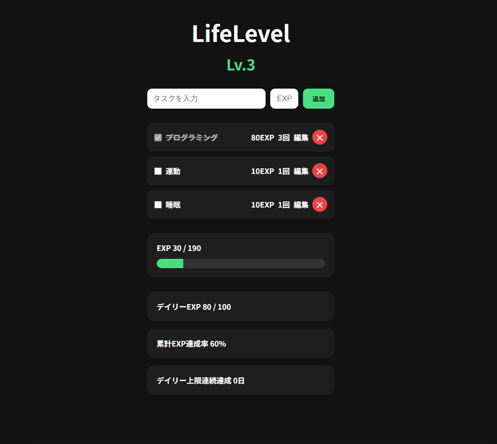

# LifeLevel

## 概要

LifeLevelは、日々のタスク達成をEXP（経験値）として記録し、
レベルアップを楽しみながら継続的にタスクに取り組めるWebアプリです。

## スクリーンショット

## デモサイト

[LifeLevelを開く](https://lupine849.github.io/LifeLevel/)

## 主な機能

- タスクの追加・削除
- タスクの達成回数の表示
- タスクのEXP編集
- タスク達成時のEXP獲得
- レベルアップ機能
- 1日のEXP上限と上限達成ボーナス
- デイリー上限連続達成の記録
- 累計EXP達成率の表示
- localStorageによるデータ保存

## 使用技術

- HTML
- CSS
- JavaScript

## 工夫した点

- タスクの達成をEXPの獲得やレベルアップにつなげ、ゲーム感覚で楽しめるようにしました。
- タスクごとに獲得EXPを設定・編集できるようにし、重要度の変化に応じて調整できる仕組みにしました。
- 達成済みのタスクは文字を薄くし、取り消し線を表示することで、達成状況を視覚的にわかりやすくしました。
- 1日のEXP獲得量に上限を設け、急激なレベルアップによる達成感の薄れを抑え、継続するモチベーションを維持することを目指しました。
- EXPの上限達成時にボーナスを付与する仕組みを設け、毎日の目標達成に対するモチベーションを高めることを意識しました。
- タスクの達成回数と累計EXP達成率、デイリー上限連続達成を表示し、これまでの取り組みを可視化することで、継続へのモチベーションにつながるようにしました。
- localStorageを使用してデータを保存し、ページを再読み込みしてもタスクや達成状況を保持できるようにしました。